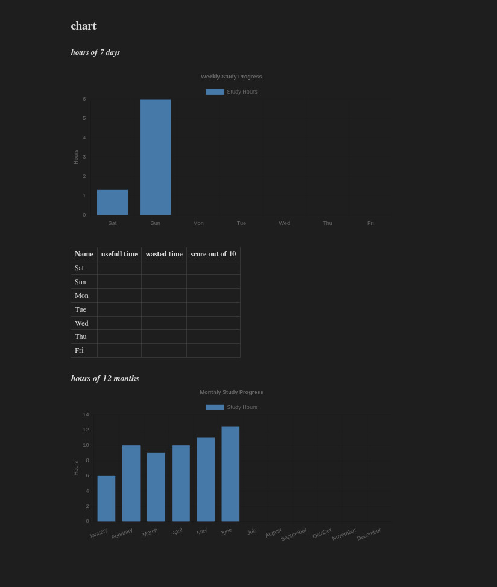

# using chart in Obsidian
> simple installation\
> lightweigh\
> avaible for ---> linux / windows / mac / android / ios\
> plugins we need --> dataview / charts\

# Download
<ins>(https://obsidian.md/download)</ins>

## Arch
**sudo pacmn -S obsidian**

# How to use 
> after you installed obsidian\
> go to settings>community plugins>Browse\ 
> search for ***dataview*** and ***charts*** plugins\
> install and enable them\

# Notice!
enable javascript queries in dataview setting 
> settings > community plugins > dataview settings
# Read more
[charts:](https://github.com/phibr0/obsidian-charts?tab=readme-ov-file)\
[dataview:](https://github.com/blacksmithgu/obsidian-dataview)
